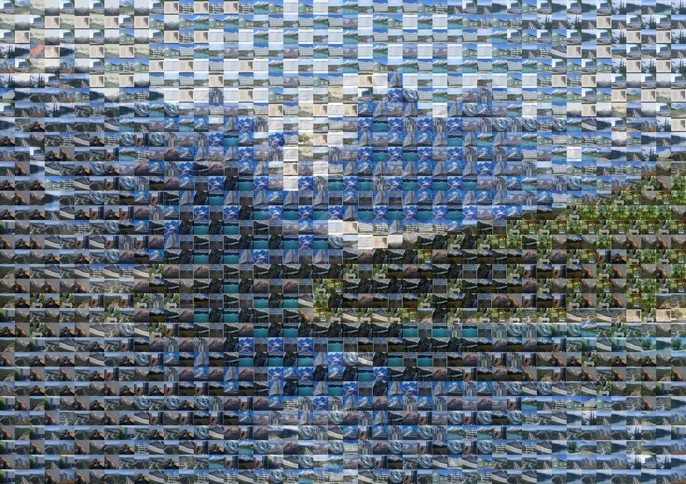
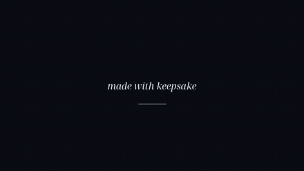

<div align="center">
  
  <h1>keepsake</h1>
  <p><strong>Turn years of photos and favorite songs into a beat-synced 4K keepsake video and a print-ready photomosaic portrait.</strong></p>

  <p>
    <a href="https://github.com/kopib/keepsake/actions/workflows/ci.yml"></a>
    <a href="https://www.python.org/downloads/"></a>
    <a href="LICENSE"></a>
    <a href="https://docs.astral.sh/ruff/"></a>
    <a href="https://docs.astral.sh/uv/"></a>
    <a href="https://ffmpeg.org/"></a>
  </p>
</div>

`keepsake` is a config-driven Python toolkit built for real-world photo libraries—mixing iPhone HEICs, JPEGs, and DSLR RAWs—with a decoupled JSON manifest so you can preview, tweak, and iterate in seconds before rendering a final 4K video and 300 DPI print.

---

## Demo Preview (Canada CC0 Example)

Generated end-to-end from 50 CC0 / Public Domain Canada photos and a CC0 track using [`examples/canada/`](examples/README.md):

| Print-Ready Photomosaic (Moraine Lake) | Live Mosaic Puzzle Finale |
| :---: | :---: |
|  |  |

> Want to run this demo yourself in ~30 seconds? Follow the step-by-step guide in **[`examples/README.md`](examples/README.md)**.

---

## Why keepsake?

Most slideshow makers produce static, uniform 4-second fades over an uncut song. `keepsake` is designed to feel like a hand-edited highlight film:

- **Curated, chronological manifests:** Extracts EXIF timestamps, GPS coordinates, and camera models across JPG, PNG, WEBP, TIFF, iPhone HEIC/HEIF, and DSLR RAW (optional `rawpy`), fixes DSLR timezone drift, filters blurry shots, and groups burst duplicates in parallel.
- **Multi-song climax medley:** Slice exact `[start, end]` highlights from multiple tracks—or let `keepsake` auto-detect each song's loudest climax—then loudness-normalize (`loudnorm`) and crossfade them seamlessly.
- **Music- and context-driven variable pacing:** Extracts an energy curve and spectral-flux beat onsets from your soundtrack so quiet vocal sections hold sharp hero shots (`1.5s–2.4s`), while explosive choruses and burst sequences trigger crisp `0.2s–0.45s` beat-locked hard cuts.
- **Calm, cinematic motion:** Centered Ken Burns zoom depth scales gently with music energy (with optional subtle landscape pan or static cuts), paired with clean `Year 2021` / `Year 2022` cards (or trip chapters) and an optional closing quote card.
- **Print-ready photomosaic + live puzzle finale:** Builds 300 DPI portraits (`A4`, `A3`, `A2`, `30x40`, `50x70`) using 3×3 CIE Lab `cKDTree` matching with reuse and spacing caps—then animates all mosaic tiles flying into place live like a puzzle during the final 10–15 seconds of your video.

---

## Pipeline Overview

```text
photos_dir ──▶ scan ──▶ manifest.json ──▶ mosaic ──▶ mosaic.jpg (+ .grid.json)
                              │                             │
audio_dir  ──▶ audio ─────────┴──▶ plan ──▶ video ──────────┴──▶ keepsake.mp4
```

Every stage reads/writes plain local files (`keepsake.toml`, `manifest.json`, `mosaic.jpg`, `keepsake.mp4`), so you can rerun any single step without starting over.

---

## Requirements

- **Python 3.12+** and [`uv`](https://docs.astral.sh/uv/)
- **`ffmpeg` and `ffprobe`** installed and available on `PATH`
  - Ubuntu / Debian: `sudo apt install ffmpeg`
  - macOS: `brew install ffmpeg`

### Installation

```bash
git clone https://github.com/kopib/keepsake.git
cd keepsake
uv sync

# Optional: enable DSLR RAW decoding (.dng, .cr2, .cr3, .nef, .arw, .raf, .orf)
uv sync --extra raw
```

---

## Quick Start

### 1. Create your project config

Copy the fully commented template [`keepsake.example.toml`](keepsake.example.toml) to `keepsake.toml` (gitignored by default) and point it at your folders:

```toml
[project]
photos_dir   = "./inputs/photos"
target_image = "./inputs/portrait.jpg"
out_dir      = "./output"
audio_dir    = "./inputs/audio"

# Optional: pick exact climax windows for specific tracks
[[project.audio_clips]]
path  = "01_song.mp3"
start = "01:35"
end   = "02:15"

[mosaic]
paper_size    = "A4"      # "A4", "A3", "A2", "30x40", "50x70"
dpi           = 300
cols          = 52
overlay_alpha = 0.14

[video]
resolution            = "720P"     # Switch to "4K" + preset = "medium" for final export
preset                = "ultrafast"
pacing_mode           = "dynamic"
target_avg_clip_sec   = 0.80
camera_motion         = "zoom"
title_card_mode       = "year"     # "year", "chapter", or "none"
closing_quote         = "your closing quote here"
mosaic_finale_sec     = 12.0
mosaic_finale_style   = "puzzle"   # "puzzle" or "zoom"
```

See [`keepsake.example.toml`](keepsake.example.toml) for every supported option and aligned descriptions.

### 2. Run everything in one command

```bash
uv run keepsake --config keepsake.toml run
```

This scans your photos, builds `<out_dir>/mosaic.jpg`, mixes and analyzes your audio, plans variable photo durations, and renders `<out_dir>/keepsake.mp4`.

### 3. Or iterate stage by stage (recommended)

```bash
# 1. Scan photos, score sharpness, cluster trips, and write <out_dir>/manifest.json
uv run keepsake --config keepsake.toml scan

# 2. Preview your sliced/crossfaded soundtrack (<out_dir>/mix_preview.m4a)
uv run keepsake --config keepsake.toml audio

# 3. Build and tune the print-ready photomosaic (<out_dir>/mosaic.jpg)
uv run keepsake --config keepsake.toml mosaic

# 4. Preview/save beat-synced photo timings into manifest.json (editable!)
uv run keepsake --config keepsake.toml plan

# 5. Render the video (<out_dir>/keepsake.mp4) — pass --replan after changing pacing/audio
uv run keepsake --config keepsake.toml video --replan
```

**Fast preview → Final 4K workflow:**
Iterate with `resolution = "720P"`, `preset = "ultrafast"`, `crf = 24`. Once you love the rhythm and finale, switch to `resolution = "4K"`, `preset = "medium"`, `crf = 18` and run `uv run keepsake --config keepsake.toml video` (omitting `--replan` preserves your exact approved timing plan).

### Global CLI Flags

| Flag | Description |
| :--- | :--- |
| `--config PATH` | Load settings and paths from a TOML file |
| `-v`, `--verbose` | Enable debug-level logging |
| `-q`, `--quiet` | Only show warnings and errors |

---

## Importing Photos from Apple / iCloud Photos

Apple does not provide an official public API for iCloud Photos, and `keepsake` reads `.heic`/`.heif` directly—no JPEG conversion needed:

- **iCloud CLI (if Advanced Data Protection is Off and Web Access is On):**
  ```bash
  uvx icloudpd --directory ./inputs/photos --username your@appleid.com --album "Your Album Name"
  ```
- **Browser / Mac / Wi-Fi (works with Advanced Data Protection On):**
  - Download **Unmodified Originals** from `icloud.com/photos` or Apple Photos on Mac to preserve full resolution and EXIF/GPS metadata.
  - From iPhone to Linux over local Wi-Fi, tools like [LocalSend](https://localsend.org/) transfer album selections cleanly with metadata intact.

---

## Using as a Python Library

All core primitives are re-exported from the top-level `keepsake` package:

```python
from keepsake import (
    ProjectConfig,
    build_mosaic,
    cluster_trips,
    configure_logging,
    render_keepsake_video,
    scan_photos,
    select_video_photos,
)

configure_logging()
cfg = ProjectConfig.from_toml("keepsake.toml")

manifest = scan_photos(cfg.project.photos_dir, cfg.ingest)
cluster_trips(manifest, cfg.trips)
select_video_photos(manifest, cfg.ingest.max_video_photos)

mosaic = build_mosaic(
    cfg.project.target_image,
    [p.path for p in manifest.photos if p.selected_for_mosaic],
    "output/mosaic.jpg",
    config=cfg.mosaic,
)
video = render_keepsake_video(
    manifest,
    "output/keepsake.mp4",
    config=cfg.video,
    audio_specs=cfg.project.resolved_audio_specs(),
    mosaic_image_path=mosaic.output_path,
    mosaic_cols=cfg.mosaic.cols,
)
```

---

## Project Structure

```text
src/keepsake/
├── __init__.py       # Public Python API exports
├── cli.py            # Main CLI orchestrator (`keepsake` entrypoint)
├── _audio.py         # Climax detection, loudness mixing, beat/energy extraction
├── _config.py        # Dataclass configs, paper/video presets, TOML loader
├── _curate.py        # Parallel scanning, sharpness & burst curation
├── _image_io.py      # Unified JPG/PNG/HEIC/RAW loader with EXIF orientation
├── _logging.py       # Color-aware stdlib logger
├── _metadata.py      # EXIF/GPS parsing, clock offset calibration, sharpness, dhash
├── _models.py        # Manifest, PhotoRecord, TripChapter serialization
├── _mosaic.py        # CIE Lab photomosaic builder, zoom reveal, live puzzle finale
├── _pacing.py        # Context- and audio-driven variable pacing planner
├── _trips.py         # Time/GPS clustering and cached Nominatim geocoding
└── _video.py         # Frame composition, Ken Burns/beat punch, hybrid concat/xfade
```

---

## Contributing

Contributions, bug reports, and ideas are welcome!

### Development Setup

```bash
uv sync --group dev
uv run pytest -v
uvx ruff check .
uvx ruff format --check .
```

### Guidelines

1. **Keep dependencies minimal:** Prefer Python stdlib, `numpy`, `scipy`, `Pillow`, and `ffmpeg` filters over heavy third-party packages.
2. **Preserve config & manifest compatibility:** New config options should have sensible defaults, be documented in [`keepsake.example.toml`](keepsake.example.toml), and keep existing `manifest.json` files loadable.
3. **Use the package logger:** Log via `get_logger(__name__)` from `keepsake._logging` rather than raw `print()` statements.
4. **Add tests for new behavior:** Every new feature or bug fix should include fast, deterministic tests in [`tests/test_pipeline.py`](tests/test_pipeline.py) (no network calls or external personal files required).
5. **Before opening a PR:**
   - Confirm `uv run pytest -v` passes completely.
   - Format and lint with `uvx ruff format .` and `uvx ruff check .`.
   - Verify [`keepsake.example.toml`](keepsake.example.toml) parses cleanly with zero unknown-key warnings.
   - Make sure personal files (`keepsake.toml`, `inputs/`, `output/`) stay untracked via [`.gitignore`](.gitignore).

---

## License

This project is licensed under the **MIT License** — see [`LICENSE`](LICENSE) for details.
